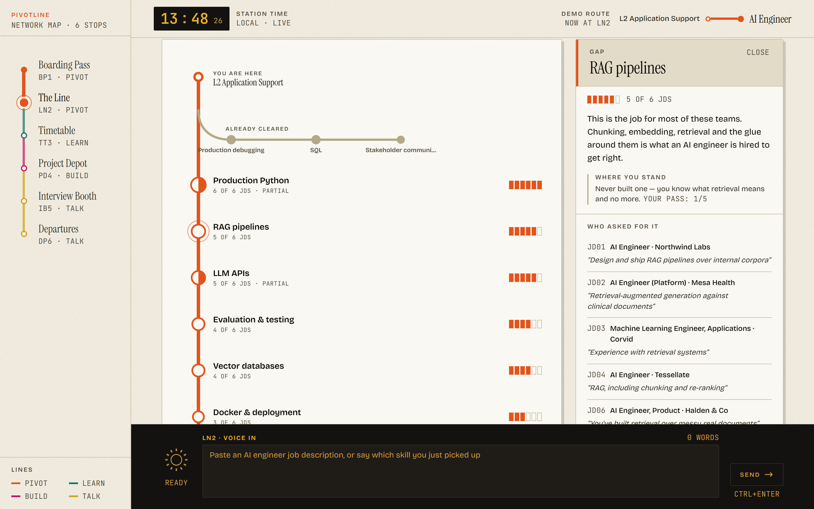
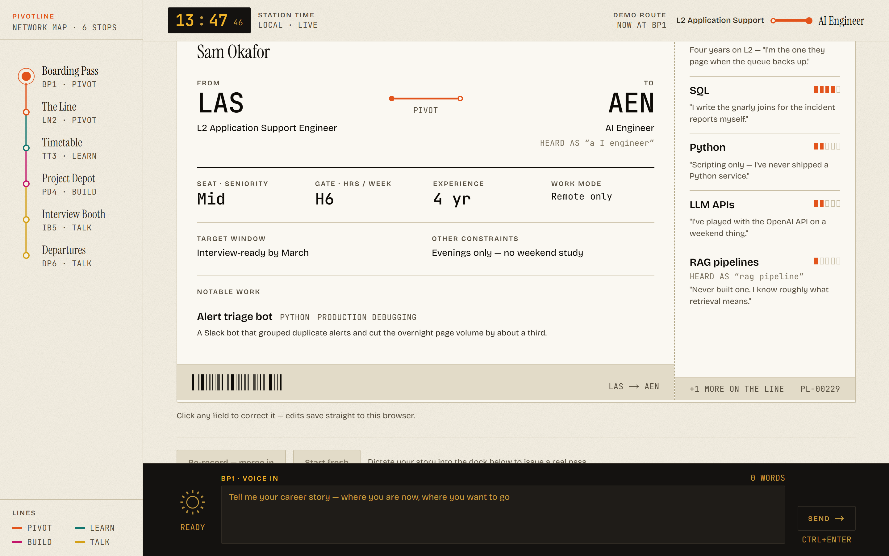
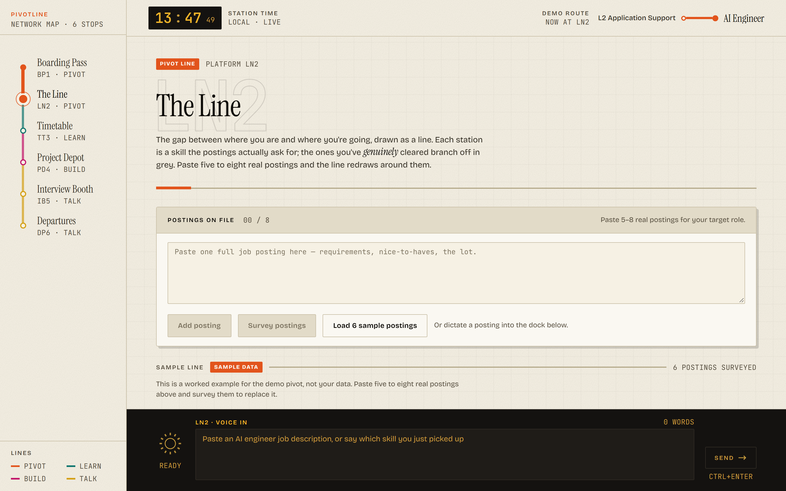
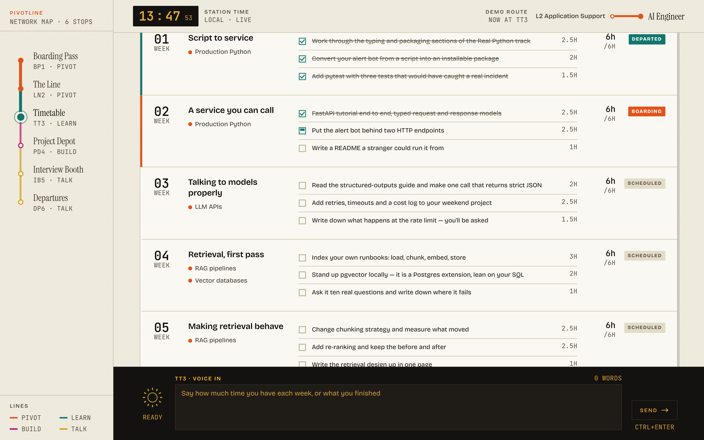
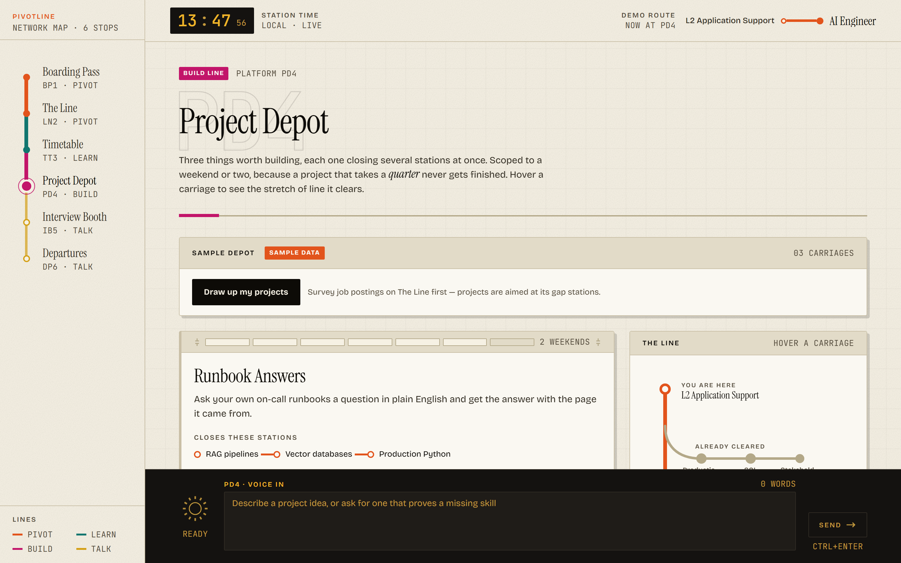
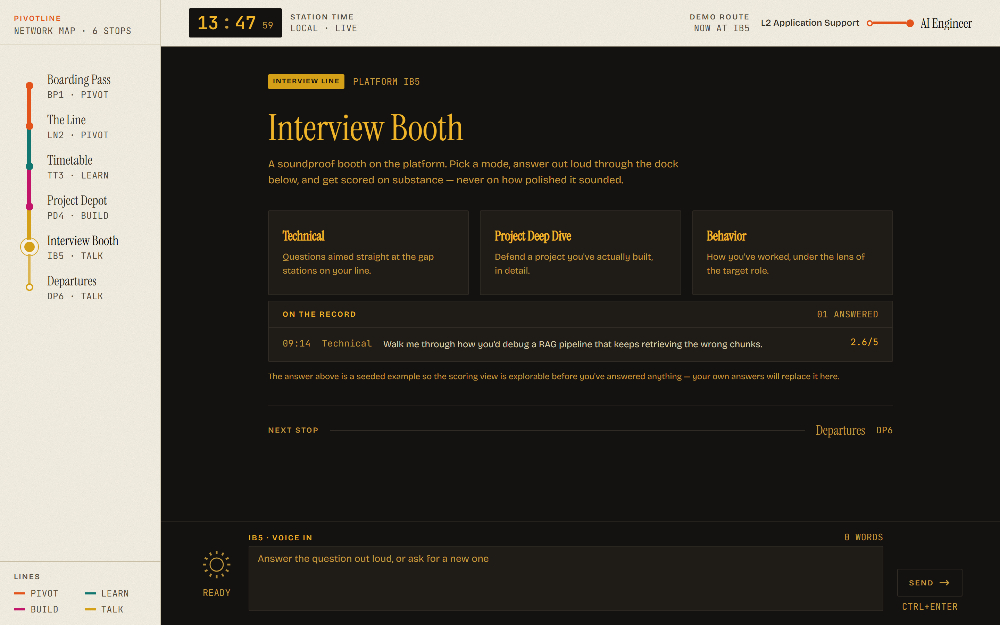
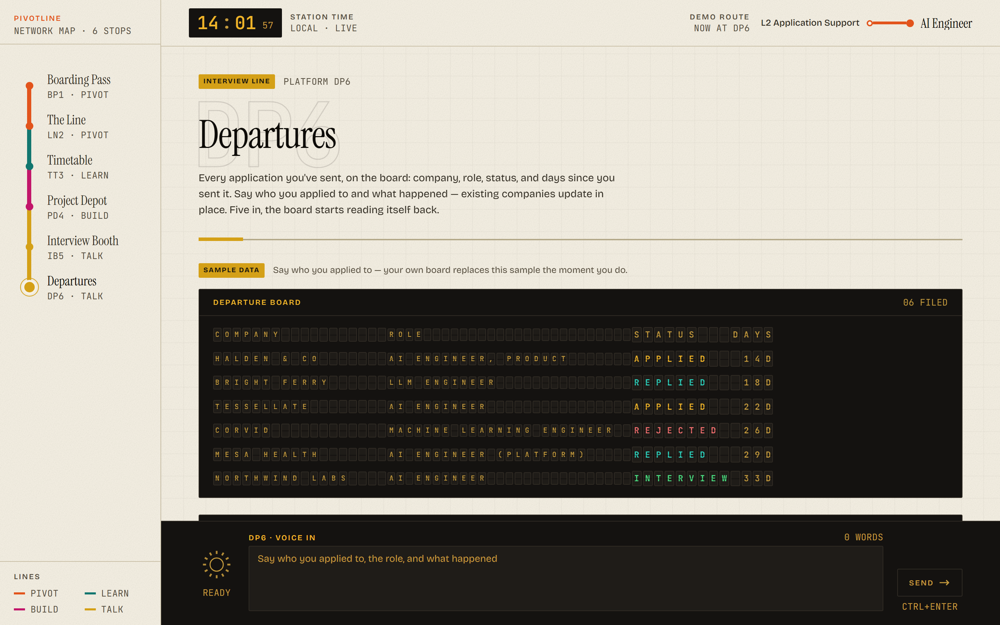
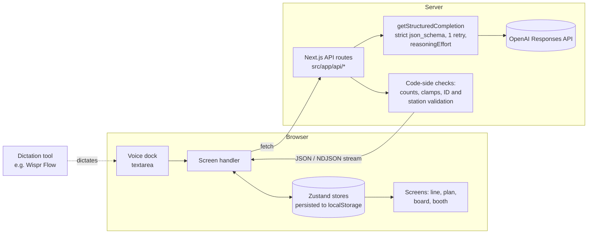

# PivotLine

**A voice-first career pivot coach that draws the gap between your skills and a target role as a metro line, then plans, builds, interviews and tracks you along it.**

**Live: [pivot-line.vercel.app](https://pivot-line.vercel.app)** · no login, no database, fully explorable with seeded demo data



*The Line. Click a gap station to see how many postings asked for it and the verbatim phrase each one used. The "5 of 6" is counted in code, not stated by the model.*

---

## The problem

Career pivots stall on three things: not knowing which skills the target role actually demands, not knowing what to do about it week to week, and not practising the interview. PivotLine takes your spoken career story and real pasted job descriptions, and turns them into a gap map, a weekly plan, portfolio projects, scored mock interviews and an application tracker.

## The six screens

Screenshots below are the seeded demo state (a fictional "Sam Okafor", L2 support → AI Engineer). Phone-width versions are in [`docs/screenshots`](docs/screenshots).

| Screen | What it does |
| --- | --- |
| **Boarding Pass** (`/boarding-pass`) <br>  | Dictate a messy career story (or paste résumé text). One extraction call turns it into a structured profile printed as an editable ticket. Re-dictating *merges* into the profile; the latest statement about a fact wins. If you never name a target role, it asks rather than guessing. |
| **The Line** (`/line`) <br>  | Paste 5–8 job postings. Skills are normalised across them and judged `gap` / `partial` / `have` against your profile, then drawn as a metro line ordered by dependency, then demand. Every station shows which postings asked for it and the quote they used. |
| **Timetable** (`/timetable`) <br>  | Builds a 6–8 week plan fitted to your weekly hours. Dictate how the week actually went and it returns a *proposal* (tasks done, stations moved, work dropped or added) shown as a diff you accept or reject. |
| **Project Depot** (`/project-depot`) <br>  | Three portfolio projects, each closing several gap stations, scoped to one or two weekends and built on your own background. Accepting one threads its tasks into the weeks that already cover those stations. Dictation steers the next set. |
| **Interview Booth** (`/interview-booth`) <br>  | Technical, project deep-dive or behavioural mode. One question at a time (read aloud via the browser's speech synthesis, mutable), difficulty adapting to your recent scores. Answers are scored 1–5 on five criteria, each with a verbatim evidence quote, a fix and a stronger example. |
| **Departures** (`/departures`) <br>  | Dictate "applied to X, Y replied" and a split-flap departure board updates in place, one record per company. At five or more applications it reads response rates per tag and proposes one change to your plan. |

## Engineering decisions

Everything below is in the code; file paths are given so you can check.

### 1. Every AI call is structured JSON, validated, and retried once
All nine routes under `src/app/api/*` call a single helper, [`structuredCompletion.ts`](src/lib/ai/structuredCompletion.ts), which uses the OpenAI Responses API with `json_schema` in `strict: true` mode. If the call fails or the output doesn't parse, it retries **once** with a stricter instruction appended, then throws with both errors. Schemas live next to the domain logic (`src/lib/*.ts`), so the type and the schema for each shape sit in one file. The helper refuses to run in the browser and the key is only ever read server-side.

### 2. Reasoning effort is chosen per task
`getStructuredCompletion` takes `reasoningEffort` (default `low`). Extraction and generation run at `low`; judgement runs at `medium`:

| `low` | `medium` |
| --- | --- |
| Profile extraction · skill-map survey · interview question · application parsing | Weekly plan · check-in proposal · project ideas · answer scoring · response-rate insights |

One deliberate exception: the skill-map survey does judging work (`gap` / `partial` / `have`) but runs at `low`, traded for speed on a live demo. It's noted in the route and is a one-line change back.

### 3. The model never does the arithmetic; code does
The model is told not to count, and every number a user sees is computed from the model's structured output:
- **Demand tags** ("5 of 6 postings"): the model returns canonical skills with the raw `aliases` that fold into them; [`/api/skill-map`](src/app/api/skill-map/route.ts) matches those back to its own per-posting extraction. One posting gets one vote per skill, a raw name can only be claimed by one skill, and any skill no posting actually mentioned is dropped, so a station has to be earned by a real mention.
- **Interview overall score**: mean of the five criteria, computed in [`interview.ts`](src/lib/interview.ts). Scores are clamped to 1–5; a station is flagged only after two answers scoring ≤ 2 target it.
- **Response rates**: [`tagResponseRates`](src/lib/applications.ts) is computed before the insights route is called. The prompt gives the model the counts and tells it not to recompute or cite anything else.
- **Line order**: a dependency-then-demand ordering in `orderMainLine`, with a guard so a dependency cycle from the model can't hang it or drop stations.

### 4. Skill-map pipeline: extract → normalise → count in code
The survey went through two designs. The first made one call per posting to extract skills, then a second call to normalise and judge them. It was correct but slow, since the round trip between stages was most of the wait. The current version (`a40d0de`) does both phases in **one call** (the schema returns `jobs` and `skills` together, in posting order), then recounts in code as above. The cost is `low` effort for judgement quality; the gain is no inter-stage round trip.

### 5. "Heard as" transcription correction
Dictation mangles terms ("rag pipeline", "a I engineer"). The profile prompt tells the model to restore a term only when context makes it unambiguous, and to record each rewrite as `{heardAs, corrected}`. The ticket prints *HEARD AS "rag pipeline"* under the corrected field instead of changing it silently, so you can see and undo it. Fixes accumulate across merges and are de-duplicated ([`profile/route.ts`](src/app/api/profile/route.ts), `fixFor` in [`profile.ts`](src/lib/profile.ts)). The correction happens inside the extraction call, not as a separate step.

### 6. Surviving the Vercel timeout
The survey was dying mid-stream (commit `f910497`). What changed:
- `/api/skill-map` streams **newline-delimited JSON events** (`start`, `posting`, `mapping`, `done`, `error`) rather than returning one response, and sends a **heartbeat every 10 seconds** so the connection never looks idle during the single long call. Failures arrive as an `error` event because the status line is already sent.
- Collapsed two sequential model calls into one (decision 4).
- Set `maxDuration` explicitly per route: 240 s for the survey, 120 s for plan / check-in / projects, 60 s for scoring, departures and insights.
- Separately fixed a Vercel *prerender* failure caused by `Date.now()` at module scope on the departure board; demo dates are now fixed strings.

The progress messages on the survey screen describe the running stage; they don't pretend to know a percentage.

### 7. Model output is treated as untrusted
Each route sanitises before anything reaches the user or the store:
- **Check-in**: task IDs the model invents are filtered out, and nothing can be added to or dropped from a week that's already done. A proposal is applied only on accept, from a diff.
- **Profile merge**: a thin model response can't erase facts you already confirmed; scalars fall back to the old value, empty lists fall back to the old list, and a known target role can't be un-known.
- **Departures**: invented statuses are dropped, strings are length-capped, and merging into existing companies happens in the store, not the prompt.
- **Station names** returned by the model (plan, projects, interview questions) are checked against the real skill map, and unknown ones are discarded.

### 8. Prompts that constrain the failure modes
- Skills and quotes must be **verbatim** from the posting or the speaker ("never paraphrase, never invent a quote").
- The scorer is told the answer was transcribed by a dictation tool that strips filler, and must **never score fluency or polish**, only content, with one quoted sentence of evidence per criterion.
- Resource suggestions may only name things the model is confident exist; a described project is always allowed.

### 9. No login, no database, always explorable
All client state lives in six `zustand/persist` stores (`pivotline:profile`, `:skillmap`, `:plan`, `:interview`, `:departures`, `:journey`). Every screen renders seeded, clearly labelled **Sample data** until you produce your own, so it works with no API key. Hydration uses `useSyncExternalStore` so server and client first renders match. "Start fresh" resets every store, since everything downstream is stale once the profile changes.

### 10. One voice dock, many handlers
A single fixed dock owns the textarea; each screen registers its own submit handler via `useVoiceHandler` ([`voiceDock.ts`](src/lib/store/voiceDock.ts)), keyed by route so a late unmount can't clear a newer screen's handler. The same dictation means a different thing per screen (career story, job posting, week report, interview answer, application update).

### 11. Visual QA is scripted
[`scripts/shots.mjs`](scripts/shots.mjs) drives Playwright/Chromium across every screen at 1440×900 and 390×844, and produced the screenshots in this README. The look is specified in [`design.md`](design.md) (a "printed railway timetable" system: paper and ink tokens, no gradients, no shadows, mechanical motion).

## Architecture



## Built by voice

PivotLine is voice-first: the dock accepts dictated input from **any** dictation tool. There is no built-in speech recognition. The only audio the app produces is the browser's speech synthesis reading interview questions aloud.

I built and tested it with [Wispr Flow](https://wisprflow.ai) for dictation and Claude Code as the coding agent, dictating my instructions to the agent rather than typing them. By my Wispr Flow dashboard I dictated **6,313 words** in total, covering the build and my hackathon write-ups. That figure is self-reported and not derivable from this repo.

## Tech stack

- **Next.js 16** (App Router) · **React 19** · **TypeScript**
- **Tailwind CSS 4** · **Framer Motion**
- **Zustand 5** with `persist`
- **OpenAI SDK** (Responses API, server-side only); default model `gpt-5-mini`, overridable via `OPENAI_MODEL`
- **Playwright + Chromium** (dev) for screenshot QA
- Deployed on **Vercel**

## Run it locally

Requires Node 20+.

```bash
git clone https://github.com/Akshu2811/PivotLine.git
cd PivotLine
npm install
```

Create `.env.local` (git-ignored):

```bash
OPENAI_API_KEY=sk-...
OPENAI_MODEL=gpt-5-mini   # optional
```

```bash
npm run dev      # http://localhost:3000
```

Without a key every screen still loads with sample data; actions that need the model show an error and leave the sample in place. To dictate, focus the dock at the bottom of a screen and use your dictation tool (or just type); send with the button or **Ctrl+Enter**.

Regenerate the screenshots (dev server running):

```bash
npx playwright install chromium
node scripts/shots.mjs
```

## Known limitations and next steps

**Limitations**
- **No automated tests.** Verification so far is manual use plus screenshot QA.
- **API routes are unauthenticated and not rate-limited.** Anyone who can reach a deployment can spend its API key. Fine for a demo, not for production.
- **Data lives only in the browser.** No sync across devices; clearing site data clears everything.
- **No speech recognition or speech output beyond the browser.** Dictation needs an external tool; spoken questions use whatever voice the browser provides and are unavailable where `speechSynthesis` isn't.
- **The survey is one long call.** The UI narrates progress, but it can take a minute or more, and at `low` effort the normalisation and judging are thinner than they'd be at `medium`.
- **Weekly-hours budget is requested, not enforced.** The plan prompt says to fit the budget; code rounds hours to the half hour but doesn't verify the sum.
- **Insights are only as good as the sample.** They need five applications, and tag rates on a handful of rows are anecdotes.
- **Sample postings are invented** (six fictional ones are bundled), and nothing scrapes real job boards. You paste postings yourself.

**Next steps**
- Tests for the code-side logic (alias matching, ordering, sanitisers, merge behaviour) and a small fixture-based eval for the prompts.
- Auth and rate limiting on the API routes.
- Verify the weekly budget in code and re-ask on overflow.
- Move the survey to `medium` and measure the latency/quality trade-off.
- Optional server-side persistence and in-app speech-to-text.
